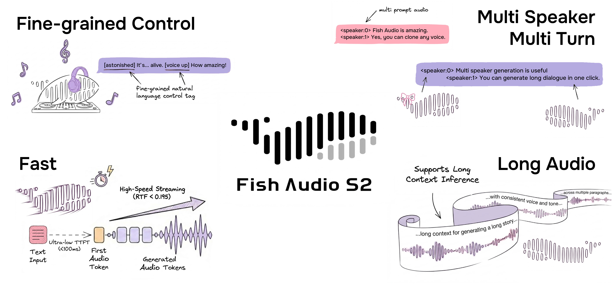

> **DGX Spark fork:** Start with the [DGX Spark setup guide](docs/en/dgx-spark.md)
> for Python 3.12, PyTorch 2.10.0, and CUDA 13 ARM64 wheels. Hardware validation
> is pending. Upstream defaults remain on PyTorch 2.8; Spark uses a separate
> opt-in uv environment. The WebUI is now served at port 8080 under `/ui`.
> Launch with `./start-webui.sh` or `./start-api.sh`; see the
> [standalone Python API client](docs/en/local-api-client.md).

<div align="center">
<h1>Fish Speech</h1>

**English** | [简体中文](docs/README.zh.md) | [Portuguese](docs/README.pt-BR.md) | [日本語](docs/README.ja.md) | [한국어](docs/README.ko.md) | [العربية](docs/README.ar.md) | [Español](docs/README.es.md)  <br>

<a href="https://www.producthunt.com/products/fish-speech?embed=true&utm_source=badge-top-post-badge&utm_medium=badge&utm_source=badge-fish&#0045;audio&#0045;s1" target="_blank"></a>
<a href="https://trendshift.io/repositories/7014" target="_blank">
    
</a>
<br>
</div>
<br>

<div align="center">
    <br>
</div>

<br>

<div align="center">
    <a target="_blank" href="https://discord.gg/Es5qTB9BcN">
        
    </a>
    <a target="_blank" href="https://hub.docker.com/r/fishaudio/fish-speech">
        
    </a>
    <a target="_blank" href="https://pd.qq.com/s/bwxia254o">
      
    </a>
</div>

<div align="center">
    <a target="_blank" href="https://huggingface.co/fishaudio/drama-3">
        
    </a>
    <a target="_blank" href="https://huggingface.co/fishaudio/s2-pro">
        
    </a>
    <a target="_blank" href="https://fish.audio/blog/fish-audio-open-sources-s2/">
        
    </a>
    <a target="_blank" href="https://arxiv.org/abs/2610.18010">
        
    </a>
</div>

> [!IMPORTANT]
> **License Notice**  
> This codebase and its associated model weights are released under **[FISH AUDIO COMMUNITY LICENSE](LICENSE)**. The S2-Pro weights remain under the Fish Audio Research License. Please refer to [LICENSE](LICENSE) for more details. We will take action against any violation of the license.

> [!WARNING]
> **Legal Disclaimer**  
> We do not hold any responsibility for any illegal usage of the codebase. Please refer to your local laws about DMCA and other related laws.

## Quick Start

### For Human

- [Installation](https://speech.fish.audio/install/): environment setup, download weights, Docker deployment
- [Inference](https://speech.fish.audio/inference/): command line, API server, WebUI

> [!IMPORTANT]
> **We strongly recommend SGLang-Omni for users who care about efficiency; see the [SGLang-Omni README](https://github.com/sgl-project/sglang-omni/blob/main/sglang_omni/models/fishaudio_drama_3/README.md).**
>
> **For vLLM Omni server, please read [vLLM-Omni Fish Speech S2 Pro Recipe](https://github.com/vllm-project/vllm-omni/blob/main/recipes/fishaudio/Fish-Speech-S2-Pro.md) and the [User Guide](https://github.com/vllm-project/vllm-omni/blob/main/docs/user_guide/examples/online_serving/text_to_speech.md#fish-speech-s2-pro).**

### For LLM Agent

```
Install and configure Fish Audio Drama 3 (or S2-Pro) by following the instructions here: https://speech.fish.audio/install/
```

## Models

| Model | Size | Weights | Description |
|------|------|-------------|-------------|
| **Drama 3** | 35B-A3B (3B active per token) | [HuggingFace](https://huggingface.co/fishaudio/drama-3) | New-generation flagship for multi-character scenes and long content, with multi-turn revision and local editing |
| S2-Pro | 4B parameters | [HuggingFace](https://huggingface.co/fishaudio/s2-pro) | Previous-generation flagship with faster inference |

The model type is detected from the checkpoint's `config.json`, and both share the same command line and API server.

---

## Fish Audio Drama 3

**The new-generation voice model, upgraded across the board over S2-Pro.**

Like the S2 series, Drama 3 supports multi-speaker generation, voice cloning and natural-language control, but it makes clear advances in long-form audio, interaction and editability.

### Key features

- **Multi-turn director revision**: guide the previous take directly ("gentler, and a bit sadder"), and the model regenerates it with that context instead of starting over.
- **Infilling and precise editing**: edit audio the way you edit text — replace a single word ("Wednesday" → "Thursday") while the surrounding timbre and transitions stay natural.
- **Scene-style multi-character production**: voice a complete scene with several characters straight from a script description, with streaming support for long text.
- **Long dialogues and long speech**: built for long recordings and extended sessions, keeping characters and timbre stable throughout.
- **Stronger expressiveness**: laughter, crying, whispers and dramatic emotion are no longer flattened by the reference, so the delivery is much closer to a real performance.
- **Multilingual voice cloning**: sets a new level of SOTA for cross-lingual cloning error rates (CER / WER).
- **Natural-language tag control**: inline tags such as `[whisper]`, `[angry]` and `[laughing]` control emotion and prosody.

### What changed compared with S2-Pro

| Capability | S2-Pro | Drama 3 |
| --- | --- | --- |
| Multi-speaker | Supported | Supported, as scene-style multi-character production |
| Voice cloning | Supported | Supported, with lower multilingual error rates |
| Inline natural-language instructions | Supported | Supported |
| Local editing / infilling | Not supported | Supported |
| Multi-turn director revision | Not supported | Supported |
| Long content | Chunked generation | Long dialogues and long speech, with streaming |
| Strong emotion (laughter, crying, whispers) | Moderate | Stronger |

### Results

Drama 3 takes a clear leap over S2 on public benchmarks: multilingual voice cloning (MiniMax Multilingual Testset), free-form speech editing (Ming-Freeform) and multi-turn emotion revision (Step-Audio-Edit), where control precision, multilingual error rates (CER / WER) and style accuracy all surpass the previous generation.

Read the [technical report](https://arxiv.org/abs/2610.18010) for the architecture, the training recipe and the full evaluation results.

---

## Fish Audio S2-Pro

Our previous-generation flagship: natural-language controllable and emotionally expressive speech, about a hundred languages, and small enough to deploy on a consumer GPU.

- **Inline natural-language instructions**: tags such as `[pause]`, `[excited]` and `[whisper]` control prosody and emotion anywhere in the text.
- **Native multi-speaker generation**: speaker IDs separate the characters inside one text, so you no longer generate and concatenate one speaker at a time.
- **Rapid voice cloning**: 10–30 seconds of reference audio is enough to reproduce a timbre.
- **Single pass**: long audio can be streamed out in one go.
- **Production streaming**: RTF 0.195 on a single H200, about 100 ms to first audio.

Visit the [Fish Audio website](https://fish.audio/) for a live playground, and read the [blog post](https://fish.audio/blog/fish-audio-open-sources-s2/) and [technical report](https://arxiv.org/abs/2603.08823) for more details.

<details>
<summary><b>S2-Pro benchmark results (click to expand)</b></summary>

| Benchmark | Fish Audio S2 |
|------|------|
| Seed-TTS Eval — WER (Chinese) | **0.54%** (best overall) |
| Seed-TTS Eval — WER (English) | **0.99%** (best overall) |
| Audio Turing Test (with instruction) | **0.515** posterior mean |
| EmergentTTS-Eval — Win Rate | **81.88%** (highest overall) |
| Fish Instruction Benchmark — TAR | **93.3%** |
| Fish Instruction Benchmark — Quality | **4.51 / 5.0** |
| Multilingual (MiniMax Testset) — Best WER | **11 of 24** languages |
| Multilingual (MiniMax Testset) — Best SIM | **17 of 24** languages |

On Seed-TTS Eval, S2 achieves the lowest WER among all evaluated models including closed-source systems: Qwen3-TTS (0.77/1.24), MiniMax Speech-02 (0.99/1.90), Seed-TTS (1.12/2.25). On the Audio Turing Test, 0.515 surpasses Seed-TTS (0.417) by 24% and MiniMax-Speech (0.387) by 33%. On EmergentTTS-Eval, S2 achieves particularly strong results in paralinguistics (91.61% win rate), questions (84.41%), and syntactic complexity (83.39%).



</details>

## Credits

- [VITS2 (daniilrobnikov)](https://github.com/daniilrobnikov/vits2)
- [Bert-VITS2](https://github.com/fishaudio/Bert-VITS2)
- [GPT VITS](https://github.com/innnky/gpt-vits)
- [MQTTS](https://github.com/b04901014/MQTTS)
- [GPT Fast](https://github.com/pytorch-labs/gpt-fast)
- [GPT-SoVITS](https://github.com/RVC-Boss/GPT-SoVITS)
- [Qwen3](https://github.com/QwenLM/Qwen3)

## Tech Report
```bibtex
@misc{fish-speech-v1.4,
      title={Fish-Speech: Leveraging Large Language Models for Advanced Multilingual Text-to-Speech Synthesis},
      author={Shijia Liao and Yuxuan Wang and Tianyu Li and Yifan Cheng and Ruoyi Zhang and Rongzhi Zhou and Yijin Xing},
      year={2024},
      eprint={2411.01156},
      archivePrefix={arXiv},
      primaryClass={cs.SD},
      url={https://arxiv.org/abs/2411.01156},
}

@misc{liao2026fishaudios2technical,
      title={Fish Audio S2 Technical Report}, 
      author={Shijia Liao and Yuxuan Wang and Songting Liu and Yifan Cheng and Ruoyi Zhang and Tianyu Li and Shidong Li and Yisheng Zheng and Xingwei Liu and Qingzheng Wang and Zhizhuo Zhou and Jiahua Liu and Xin Chen and Dawei Han},
      year={2026},
      eprint={2603.08823},
      archivePrefix={arXiv},
      primaryClass={cs.SD},
      url={https://arxiv.org/abs/2603.08823}, 
}

@misc{liao2026fishaudiodrama3technical,
      title={Fish Audio Drama 3 Technical Report}, 
      author={Dawei Han and Shidong Li and Shijia Liao and Jiahua Liu and Songting Liu and Qingzheng Wang and Yuxuan Wang and Xin Chen and Yifan Cheng and Tianyu Li and Gangin Park and Xuehao Yang and Chang Zeng and Haoyang Zhang and Ruoyi Zhang and Xiangyu Zhang},
      year={2026},
      eprint={2610.18010},
      archivePrefix={arXiv},
      primaryClass={cs.SD},
      url={https://arxiv.org/abs/2610.18010}, 
}
```
